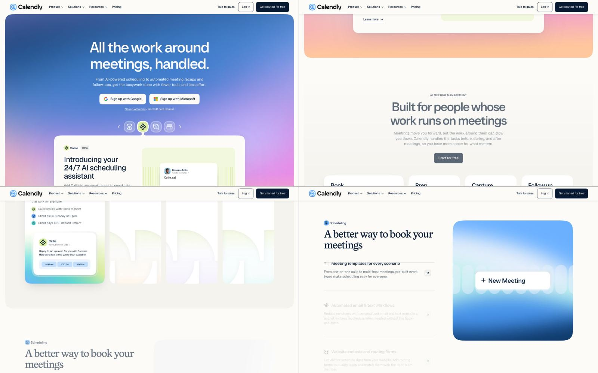
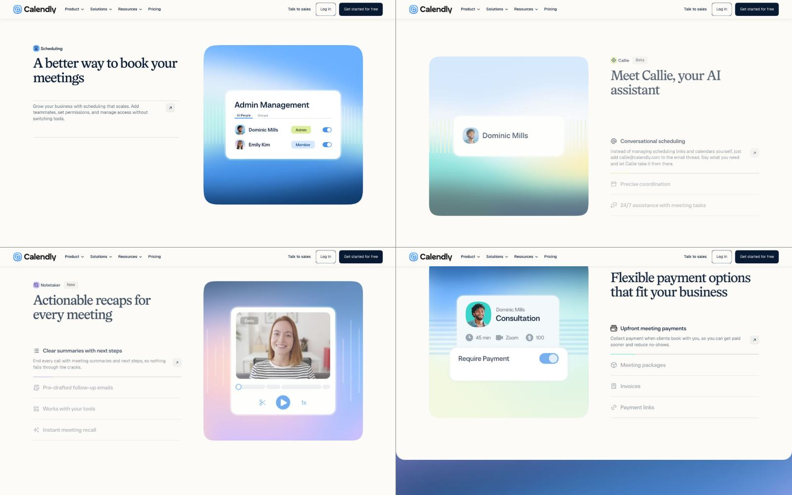
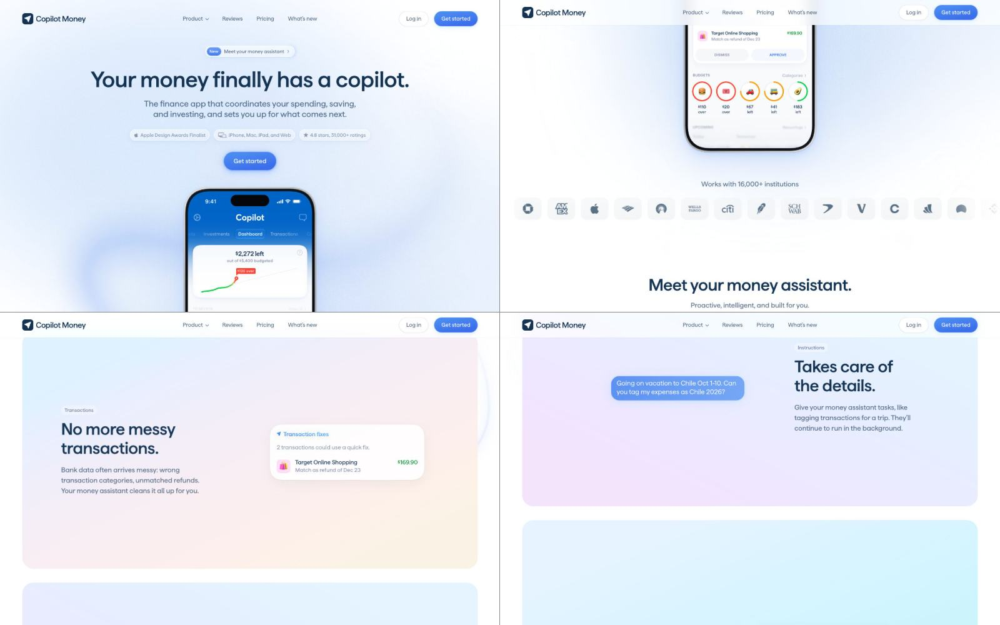
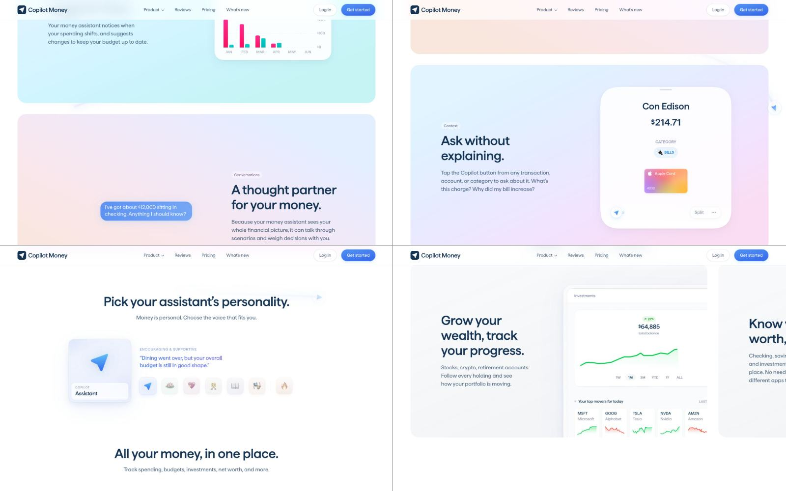
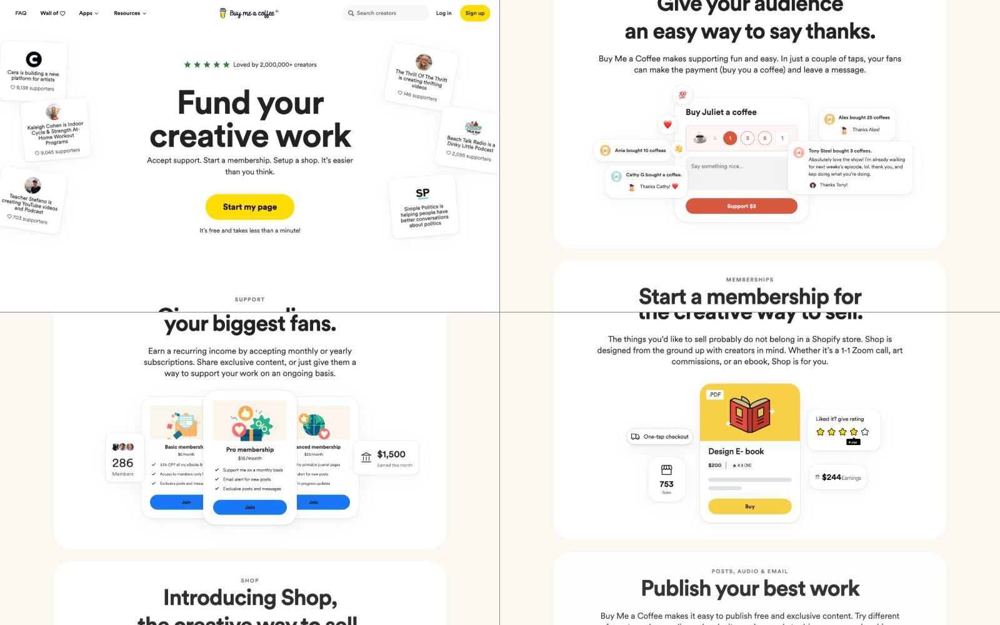
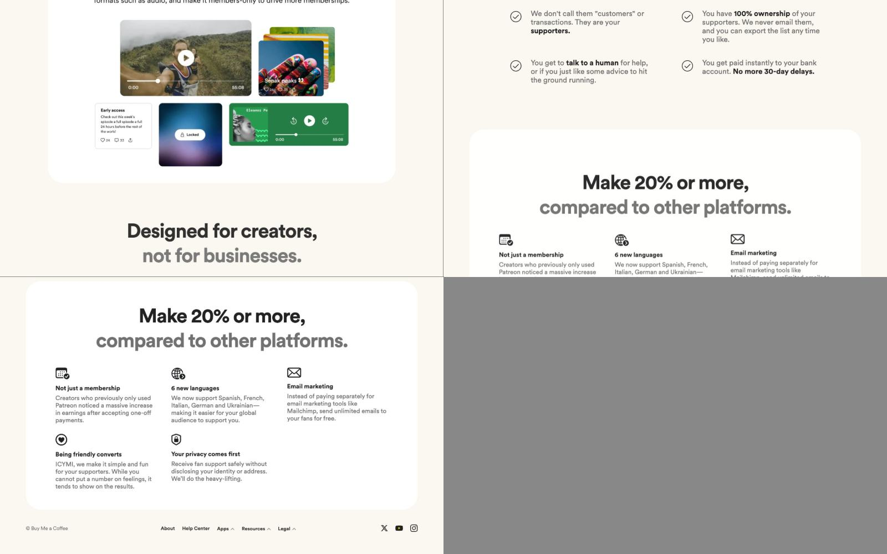
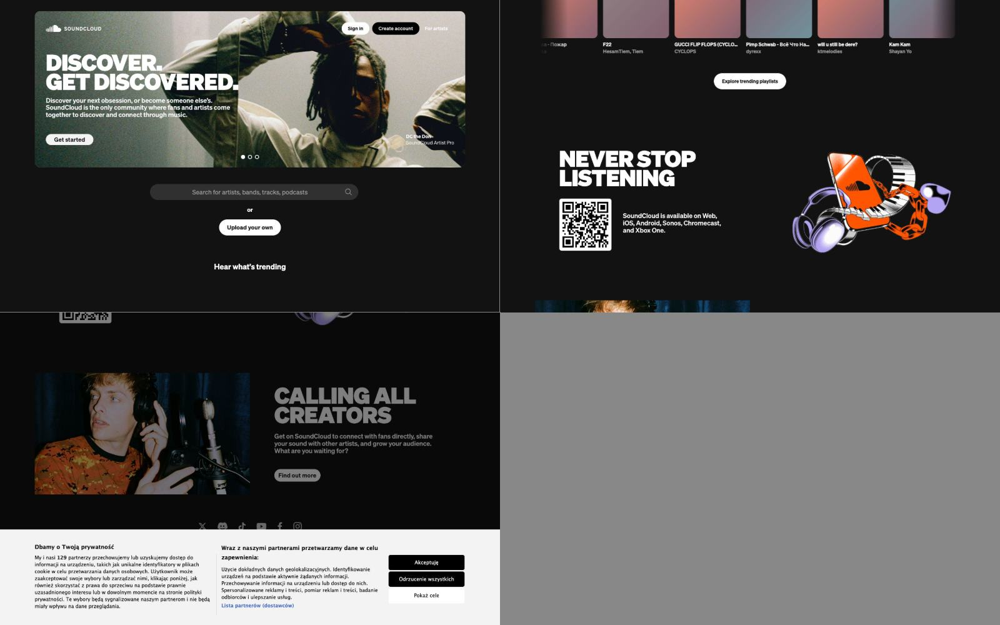
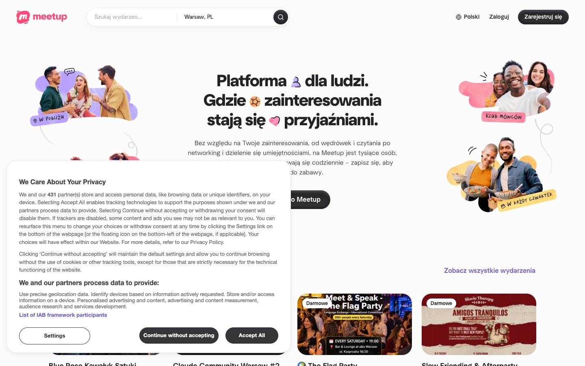
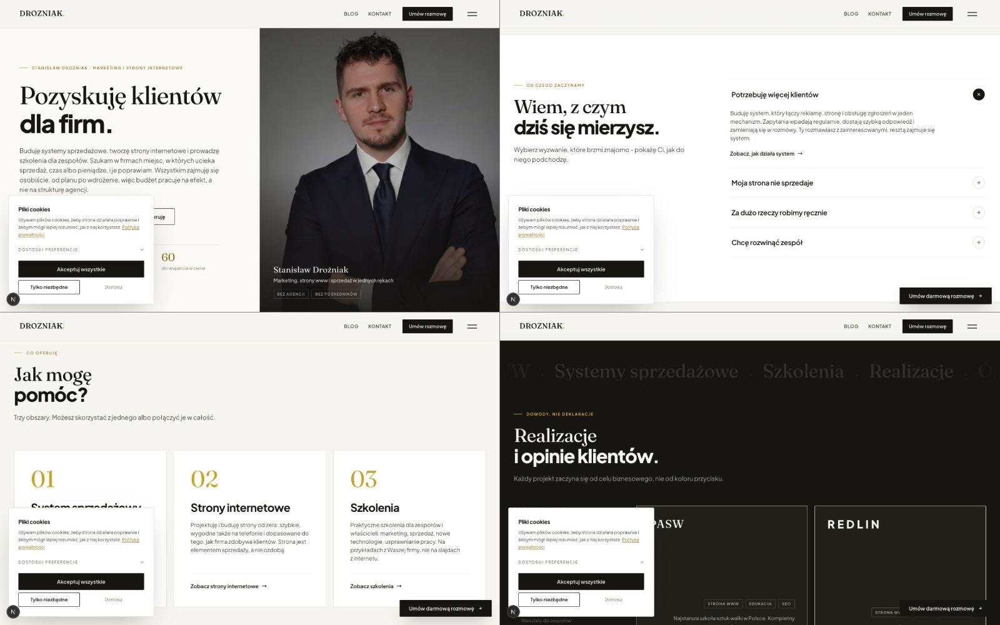

# Układ strony głównej drozniak.com: referencje i kierunek

Dokument roboczy z 6 listopada 2026. Dotyczy tylko układu: kompozycji sekcji, rytmu, ilości elementów, zdjęć i ruchu. Treść i kolejność sekcji pochodzą z `01-research-tresci.md` (część 6), sposób pisania z `02-glos.md`. Fonty i kolory zostają z obecnego systemu „Editorial Ink & Paper” (Fraunces, Plus Jakarta Sans, papier, atrament, złoto).

Zrzuty leżą w `docs/redesign/ref/`.

## Skąd są referencje

W Mobbin na koncie Stanisława zapisanych jest sześć aplikacji webowych, bez osobnych kolekcji i bez pojedynczych ekranów:

- Calendly,
- Copilot Money,
- Buy Me a Coffee,
- SoundCloud,
- Meetup,
- GetYourGuide.

Konto w Mobbin jest darmowe, więc w samym Mobbin widać tylko po kilka ekranów wnętrza każdej aplikacji, a serwer MCP Mobbin w ogóle nie odpowiada bez płatnego planu. Dlatego do oceny układu wziąłem prawdziwe strony główne tych sześciu marek, otwarte 6 listopada 2026 w szerokości 1440 px. Każdą przepuściłem przez inspektor z `design-taste-frontend`, który mierzy rozmiary pisma, liczbę zdjęć, etykiety nad nagłówkami, linie i cienie.

GetYourGuide zasłania stronę weryfikacją Cloudflare, której nie obchodziłem, więc tej referencji nie ma w opisie. Jeśli Stanisław zapisał ją z konkretnego powodu (na przykład za siatkę zdjęć albo za karty wycieczek), warto to dopisać.

Uwaga ogólna: wszystkie zapisane marki sprzedają produkt cyfrowy dla konsumenta albo małej firmy, a nie usługę doradczą. Z referencji bierzemy więc sposób komponowania, a nie dosłowne rozwiązania.

## Referencje jedna po drugiej

### Calendly

- **Siatka i rytm.** Po hero strona idzie rzędami podzielonymi na pół: z jednej strony tekst, z drugiej jeden duży kwadratowy obraz. Strony zamieniają się co rząd. Każdy rząd zajmuje mniej więcej jeden ekran i dotyczy jednej rzeczy.
- **Ilość treści na ekranie.** Nagłówek na dwie linijki, jedno zdanie wstępu i lista trzech, czterech funkcji. Opis ma tylko pierwsza z nich, reszta to same nazwy. Około 40–60 słów na ekran.
- **Typografia.** Nagłówki szeryfowe, duże i lekkie, a tekst bezszeryfowy. To ten sam układ ról co u Stanisława (Fraunces i Plus Jakarta Sans), co potwierdza, że obecne fonty pasują do jego gustu.
- **Zdjęcia.** Prawie żadnych zdjęć ludzi. Obraz to wycinek prawdziwego interfejsu (panel spotkania, płatność) położony na miękkim kolorowym tle.
- **Nawigacja.** Logo, cztery rozwijane pozycje, „Talk to sales”, logowanie i jeden ciemny przycisk.
- **Oferta.** Każdy obszar produktu dostaje własny ekran z własnym obrazem. Nie ma siatki kafelków z ikonami.
- **Ruch.** Aktywna funkcja na liście ma pasek postępu i po chwili przełącza się na następną, a obraz po prawej zmienia się razem z nią.

Do wzięcia: rząd „nagłówek z listą po lewej, jeden duży obraz po prawej”, w którym lista steruje obrazem. Nie bierzemy gradientów i drobnych ikon z etykietami nad nagłówkami.

### Copilot Money

- **Siatka i rytm.** Hero wyśrodkowane, pod nim zdjęcie telefonu z aplikacją. Dalej każda funkcja ma własne duże pole z zaokrąglonymi rogami, na pełną szerokość albo w poziomym rzędzie przewijanym w bok.
- **Ilość treści na ekranie.** Bardzo mało: nagłówek na dwie linijki, dwa, trzy zdania i jeden element interfejsu (dymek rozmowy, karta transakcji, wykres). Około 30 słów na ekran.
- **Typografia.** Jeden bezszeryfowy krój, duży nagłówek, mały tekst, prawie nic pomiędzy.
- **Zdjęcia.** Zamiast zdjęć prawdziwe fragmenty aplikacji z prawdziwymi kwotami i nazwami.
- **Nawigacja.** Logo, cztery krótkie linki, logowanie, jeden niebieski przycisk.
- **Oferta i doświadczenie.** Wiarygodność mieści się w jednym rzędzie pod hero: wyróżnienie Apple, platformy, ocena z liczbą opinii. Niżej jest rząd logotypów banków. Nie ma liczników ani rozbudowanej sekcji „dlaczego my”.
- **Ruch.** Spokojny. Elementy wjeżdżają przy przewijaniu, a rząd pól przesuwa się w bok.

Do wzięcia: „jedna myśl na ekran”, dużo powietrza wokół krótkiego tekstu i pokazanie prawdziwego wycinka pracy w miejsce opisu. Nie bierzemy pastelowych gradientów ani plakietki „New” nad nagłówkiem.

### Buy Me a Coffee

- **Siatka i rytm.** Jedna wyśrodkowana kolumna przez całą stronę. Każda sekcja to duży biały panel na kremowym tle.
- **Ilość treści na ekranie.** Nagłówek 96 px na dwie linijki, jedno, dwa zdania, jeden obraz. Najsłabszy fragment strony to lista pięciu funkcji z ikonami na końcu, która wygląda jak wszystkie inne strony.
- **Typografia.** Jeden krój, bardzo duże nagłówki. Druga linijka niektórych nagłówków jest szara, co daje dwa tony w jednym tytule bez zmiany kroju.
- **Zdjęcia.** Hero otaczają karty prawdziwych twórców z liczbą wspierających. Dowód jest pokazany na przykładach, a nie opisany.
- **Nawigacja.** Kilka linków po lewej, logo na środku, wyszukiwarka, logowanie i jeden żółty przycisk.
- **Oferta.** Trzy produkty (wsparcie, członkostwo, sklep), każdy w osobnym panelu z jednym rysunkiem złożonym z prawdziwych elementów interfejsu.
- **Ruch.** Prawie żadnego, strona działa samą skalą.

Do wzięcia: wyśrodkowane hero z jednym przyciskiem, ogromny nagłówek, prawdziwe przykłady klientów jako dowód i sekcje z jednym obrazem każda. Nie bierzemy emoji, cieni pod kartami ani końcowej siatki z ikonami.

### SoundCloud

- **Siatka i rytm.** Ciemna strona. Hero to duże zdjęcie w zaokrąglonym kadrze z nagłówkiem na nim. Dalej rzędy na zmianę: zdjęcie i tekst.
- **Ilość treści na ekranie.** Minimalna: nagłówek kapitalikami, dwa zdania, jeden przycisk.
- **Typografia.** Ciężki, ściśnięty grotesk pisany wersalikami, bardzo zwarta interlinia. Tekst tylko w jednym rozmiarze.
- **Zdjęcia.** Prawdziwe zdjęcia artystów przy pracy, z ziarnem, nie stockowe uśmiechy.
- **Nawigacja.** Schowana w hero: logo i dwa przyciski.
- **Ruch.** Hero jest karuzelą zdjęć.

Do wzięcia: zdjęcie człowieka przy pracy jako główny obraz oraz bardzo mało słów przy dużym obrazie. Nie bierzemy wersalików ani ciemnego tła na całej stronie.

### Meetup

- **Siatka i rytm.** Wyśrodkowany nagłówek na trzy linijki, po bokach kolaże prawdziwych zdjęć ludzi z odręcznymi podpisami („W pobliżu”, „Klub mówców”). Zaraz pod hero prawdziwe wydarzenia z datami.
- **Ilość treści na ekranie.** Średnia. Nagłówek i akapit są dość długie, ale reszta ekranu to zdjęcia.
- **Typografia.** Gruby grotesk. W nagłówek wstawione są małe obrazki w miejscu słów. To ten sam chwyt, który taste nazywa „akapitem z obrazkami w tekście”.
- **Zdjęcia.** Dużo, prawdziwi ludzie, wycięci i ułożeni na kolorowych plamach.
- **Nawigacja.** Logo, wyszukiwarka z miastem, język, logowanie, jeden przycisk.
- **Oferta.** Produkt pokazany od razu (lista wydarzeń), bez opisywania, co to jest.

Do wzięcia: obrazek wstawiony w zdanie i pokazanie prawdziwej zawartości tuż pod hero. Nie bierzemy wyciętych postaci na plamach, bo do usług doradczych pasują słabo.

## Co się powtarza, czyli gust Stanisława

1. **Jedna rzecz na ekran.** Każda sekcja ma jeden nagłówek, kilka zdań i jeden obraz. Żadna z referencji nie upycha w jednym ekranie nagłówka, wstępu, czterech kart i paska liczb.
2. **Duży nagłówek, mało tekstu.** Nagłówki mają 64–96 px i najwyżej dwie linijki. Pod nimi jest jedno, dwa zdania. Średnio 30–60 słów na ekran.
3. **Pokazane zamiast opisane.** Zamiast ikon i przymiotników jest prawdziwy wycinek: panel Calendly, transakcja w Copilot, karta twórcy w Buy Me a Coffee, wydarzenie w Meetup.
4. **Dużo powietrza i duże płaszczyzny.** Sekcje oddziela zmiana tła albo duży panel, a nie linie. Odstępy między sekcjami są wyraźnie większe niż odstępy w środku sekcji.
5. **Wyśrodkowane hero z jednym przyciskiem** (Copilot, Buy Me a Coffee, Meetup, Calendly). Pod nim od razu coś prawdziwego: aplikacja, przykłady albo wydarzenia.
6. **Spokojna nawigacja:** logo, kilka linków, jeden wyraźny przycisk.
7. **Dowód w jednym miejscu i krótko:** rząd faktów pod hero albo prawdziwe przykłady. Bez liczników i bez sekcji „dlaczego ja”.
8. **Ciepłe, przyjazne strony produktowe, a nie agencyjne.** Nikt tu nie gra „premium” czernią i złotem. Strony są jasne, czytelne i trochę miękkie.

Czego referencje robią źle i co pomijamy: gradienty (Calendly, Copilot), cienie pod kartami (Buy Me a Coffee), emoji, małe etykiety nad nagłówkami (Calendly, Buy Me a Coffee, Copilot) i końcowa siatka funkcji z ikonami (Buy Me a Coffee). Wszystkie te rzeczy inspektor na nich złapał.

## Obecna strona: gdzie układ wygląda na wygenerowany

Pomiar z 6 listopada 2026, `localhost:3000`, szerokości 1440, 768 i 390 px. Inspektor zgłosił 10 błędów i 7 ostrzeżeń. Zrzuty: `ref/obecna-desktop-1.jpg`, `ref/obecna-desktop-2.jpg`, `ref/obecna-telefon-1.jpg`.

### Etykiety nad nagłówkami i kropki

- Nad każdym nagłówkiem sekcji stoi eyebrow z kreską: „Od czego zaczynamy”, „Co oferuję”, „Dowody, nie deklaracje”, „Jak pracuję”, „Dlaczego ze mną”, a w stopce „Masz projekt?”. Wszystkie przez `SectionIntro` (`app/components/pub/SectionIntro.tsx`) i klasę `.pub-eyebrow` w `app/globals.css`.
- W hero eyebrow z kropką środkową: „Stanisław Drożniak · marketing i strony internetowe” (`app/page.tsx:149`).
- Kropki `·` w przewijanym pasie słów nad portfolio (`app/page.tsx:319`) i w pasku pod końcowym przyciskiem: „20 min online · Zero zobowiązań · Odpowiedź w 24h” (`app/page.tsx:474-479`).
- Tytuł strony w metadanych też ma kropkę: „Stanisław Drożniak · Pozyskuję klientów dla firm”.

### Prostokąciki i plakietki

- Plakietki „Bez agencji” i „Bez pośredników” na zdjęciu w hero (`app/page.tsx:209-212`).
- Plakietki certyfikatów „Adobe”, „Meta”, „University of California” (`app/page.tsx:437-441`).
- Tagi „Strona WWW”, „Edukacja”, „SEO” na kartach realizacji (`ShowcaseTabs.tsx`).
- Inspektor policzył 22 małe etykiety kapitalikami z rozstrzeleniem i 13 bloków tekstu poniżej 13 px.

### Numeracja i karty w siatce

- Trzy karty usług w rzędzie z numerami 01, 02, 03 (`app/page.tsx:275-303`). To najbardziej szablonowy fragment strony.
- Proces w czterech kolumnach z numerami 01–04 (`app/page.tsx:356-385`).
- Cztery kolumny liczb „9+ lat, 24 h, 2–4 tyg., 60 dni” (`app/page.tsx:400-429`). Trzy z tych liczb już raz padły w hero (`HeroFact`, `app/page.tsx:180-184`), więc strona mówi to samo dwa razy. Liczby dodatkowo nabijają się animacją (`CountUp`).
- Złota kreska, która wysuwa się nad kartą przy najechaniu, powtarza się w czterech komponentach.

### Linie i ramki

- 19 cienkich linii (pod nagłówkiem strony, między panelami hero, nad faktami, między kolumnami procesu i liczb, w akordeonie) i 6 obrysowanych ramek.

### Sekcje-podsumowania i powtórzenia

- „Konkrety, nie obietnice” to sekcja, która tylko powtarza fakty z hero.
- Na końcu strony stoją dwa zamknięcia jedno pod drugim: „Porozmawiajmy o Twojej firmie” na beżowym tle, a zaraz pod nim w stopce „Porozmawiajmy.” z tymi samymi dwoma przyciskami.
- Przycisk „Umów darmową rozmowę” wisi przyklejony w prawym dolnym rogu przez całą stronę (`StickyCTA.tsx`), choć ten sam przycisk jest w pasku nawigacji. Na telefonie zasłania treść.
- Przewijane paski: nazwy firm pod hero i duże blade słowa „Strony WWW, Systemy sprzedażowe, Szkolenia…” nad portfolio.

### Za dużo na ekranie

- Pierwszy ekran ma etykietę, nagłówek w dwóch krojach, akapit na pięć linijek, dwa przyciski, trzy fakty z liczbami, zdjęcie z podpisem, rolę i dwie plakietki. Wszystkiego jest tu około dwunastu rzeczy, a w referencjach są cztery: nagłówek, zdanie, przycisk, obraz.
- 18 różnych rozmiarów pisma (od 11 do 88 px), a tekst główny ma 15 px.
- Na stronie są trzy zdjęcia, z czego dwa to portfolio stron, które wypada z oferty.

### Rzeczy techniczne, które wyszły przy okazji

- Przy włączonym w systemie ograniczeniu ruchu 13 elementów pierwszego ekranu zostaje niewidocznych, w tym nagłówek. Animacje wejścia nie mają wersji bez ruchu.
- Na telefonie nagłówek hero łamie się na trzy linijki.
- Nazwy firm w pasku mają kontrast 3,6:1 (potrzeba 4,5:1).
- Pełny układ zasłaniają baner cookies i lepki przycisk, ale to sprawa osobna.

### Co zostaje

- Fraunces do nagłówków, Plus Jakarta Sans do tekstu.
- Papier `#F6F5F1`, biel, atrament `#161511`, złoto jako jedyny akcent, ciemne pole `#171512` na jedną, dwie sekcje.
- Spokojny pasek nawigacji z wordmarkiem.

Jedna zmiana w sposobie używania fontów, do decyzji Stanisława: dziś każdy nagłówek ma pierwszą linijkę szeryfem, a drugą grubym bezszeryfowym („Wiem, z czym / **dziś się mierzysz.**”). Inspektor liczy to jako typowy chwyt generowanych stron, a w referencjach nikt tak nie robi. Propozycja: nagłówki w całości Fraunces, tekst w całości Plus Jakarta Sans, a waga 800 tylko tam, gdzie coś ma krzyczeć (na przykład nazwa w stopce). Fonty i kolory zostają, zmienia się tylko to, że jeden nagłówek nie zmienia kroju w połowie.

Inspektor zgłasza też tło `#F6F5F1` jako „kremowe”. Stanisław chce je zostawić, więc zostaje. Gdyby przy pierwszym zrzucie nowej strony wyglądało za żółto, można je przesunąć o pół tonu w stronę szarości (np. `#F4F3F0`), bez zmiany charakteru.

## Zasady dla nowego układu

Obowiązują w obu wariantach.

1. **Jedna rzecz na ekran.** Sekcja ma jeden nagłówek, najwyżej trzy zdania wstępu i jeden obraz albo jedną listę.
2. **Bez eyebrow, numeracji, plakietek, kropek środkowych, linii i obrysowanych kart.** Sekcje oddziela odstęp (160–200 px na komputerze, 96–120 px na telefonie) albo zmiana tła na całą szerokość.
3. **Pięć rozmiarów pisma** w całym serwisie:
   - nagłówek strony: Fraunces, `clamp(48px, 6.4vw, 96px)`,
   - nagłówek sekcji: Fraunces, `clamp(34px, 4vw, 60px)`,
   - zdanie wiodące i duże cytaty: 22–26 px,
   - tekst: 18 px, interlinia 1,55, w pełnym atramencie (nie szary),
   - drobny tekst: 14 px.
4. **Nagłówki najwyżej na dwie linijki** w każdej szerokości, zdaniową wielką literą, nazywające temat („Z czym przychodzą firmy”, „Jak wygląda współpraca”).
5. **Jeden przycisk główny** („Umów rozmowę”) w hero, w pasku nawigacji i w kontakcie. Bez lepkiego przycisku w rogu. Jeden kształt przycisków i jeden promień zaokrąglenia na całej stronie.
6. **Jedno zamknięcie strony.** Kontakt i stopka to jedna sekcja.
7. **Zdjęcia prawdziwe, minimum cztery na stronie** (dziś są trzy, z czego dwa wypadają). Szczegóły w części o zdjęciach.
8. **Nawigacja widoczna na komputerze:** wordmark, „Współpraca”, „Szkolenia”, „Blog”, „O mnie”, przycisk „Umów rozmowę”. Menu na cały ekran tylko na telefonie.
9. **Ruch tylko tam, gdzie coś wnosi** (opis w części o ruchu). Każda animacja ma wersję dla ograniczonego ruchu, w której treść jest od razu widoczna.

## Kolejność sekcji

Na podstawie `01-research-tresci.md`, część 6, z trzema zmianami, żeby strona była krótsza:

| Sekcja z dokumentu 01 | Co z nią robię w układzie |
|---|---|
| 6.1 Hero | zostaje |
| 6.2 Firmy, z którymi pracuję | zostaje |
| 6.3 Z czym przychodzą firmy | zostaje |
| 6.4 Zakres pracy | zostaje, to sekcja z „żywym” elementem |
| 6.5 Jak wygląda współpraca | zostaje |
| 6.6 Dla kogo | wchodzi do hero (jedno zdanie) i do pytań; osobna sekcja wypada |
| 6.7 Większe firmy i szkolenia | zostaje jako niski pas, wyraźnie mniejszy od reszty |
| 6.8 O mnie | zostaje |
| 6.9 Opinie | tylko jeśli będą nowe opinie; inaczej wypada |
| 6.10 Blog | wypada ze strony głównej, zostaje w menu |
| 6.11 Pytania i odpowiedzi | zostaje |
| 6.12 Kontakt | łączy się ze stopką |

Wychodzi dziewięć sekcji i około siedmiu, ośmiu ekranów na komputerze. Dziś jest osiem ekranów, ale na każdym jest dwa razy więcej elementów.

## Wariant A: jedna rzecz na ekran

Najbliżej zapisanych referencji (Copilot, Buy Me a Coffee, Calendly). Hero wyśrodkowane, każda sekcja jako jedna duża płaszczyzna, dużo powietrza. Kierunek z taste: „The name as a monument” z blueprintami sekcji dobranymi do treści.

### Pasek nawigacji

Wordmark „DROZNIAK” po lewej, cztery linki tekstowe po prawej, przycisk „Umów rozmowę” na końcu. Tło strony, bez linii pod spodem. Po przewinięciu pasek zostaje na górze i dostaje tło o ton jaśniejsze.

### Hero

Wyśrodkowane, na jasnym tle. Nagłówek na dwie linijki w Fraunces, około 6,4 vw (na komputerze około 90 px). Pod nim w odstępie 32–40 px jedno, dwa zdania 22 px: dla kogo i co obejmuje. Niżej jeden przycisk „Umów rozmowę” i obok link „Jak wygląda współpraca”.

Pod tym, na całą szerokość treści, jeden szeroki kadr zdjęcia w proporcji około 21:9: Stanisław przy pracy z klientem albo przy stole z laptopem, nie w garniturze na szarym tle. Kadr zaczyna się jeszcze na pierwszym ekranie i dochodzi do jego dolnej krawędzi, tak jak telefon w Copilot.

Bez faktów z liczbami, plakietek i podpisu na zdjęciu. Rola („Zewnętrzny szef marketingu w Grupie Fibra i ICAROS Polska”) przechodzi do następnej sekcji.

Na telefonie: nagłówek 11–12 vw na dwie, najwyżej trzy linijki, zdanie 18 px, przycisk na pełną szerokość, pod nim zdjęcie w proporcji 4:5.

### Firmy, z którymi pracuję

Blueprint „Names as one sentence”. Nazwy firm złożone w jedno zdanie, pisane dużo (około 40–56 px, Fraunces), na pełną szerokość: „Pracuję z Grupą Fibra, ICAROS Polska, Widokownią, Bartnicky, Chess.com…”. Zdanie zaczyna się od zwykłych słów w pełnym atramencie, a nazwy są o ton jaśniejsze i co dwie sekundy jedna z nich się podświetla. Kiedy nazwa jest podświetlona, pod zdaniem pojawia się jedna linijka 18 px o roli: „Grupa Fibra, deweloper i biuro nieruchomości: prowadzę cały marketing jako zewnętrzny szef marketingu”.

To zastępuje przewijany pasek logo i pokazuje zakres roli, o który prosi dokument 01, bez tabeli i bez kart. Na telefonie zdanie ma 9 vw, a linijka z rolą jest stała pod nim.

### Z czym przychodzą firmy

Blueprint w stylu Copilot. Nagłówek sekcji po lewej, pod nim jedno zdanie. Niżej poziomy rząd sześciu dużych pól, przewijany w bok, z jednym polem widocznym w całości i brzegiem następnego. Każde pole ma około 70% szerokości ekranu, tło o ton ciemniejsze od strony i zawiera:

- sytuację słowami właściciela jako nagłówek pola (Fraunces, 34–40 px, najwyżej dwie linijki), na przykład „Z reklam przychodzą zgłoszenia, ale mało z nich kupuje”,
- dwa zdania, co z tym zwykle robię (18 px),
- jeden mały, prawdziwy wycinek z pracy po prawej stronie pola (patrz „Zdjęcia i wycinki pracy”).

Strzałki „poprzednie” i „następne” pod rzędem, przewijanie palcem na telefonie. Na telefonie pole ma pełną szerokość minus margines, wycinek idzie pod tekst.

### Zakres pracy

Wzór z Calendly, czyli żywy element strony. Rząd podzielony na pół:

- po lewej nagłówek sekcji i lista sześciu obszarów w kolejności drogi klienta (reklama płatna, landingi i oferty, obsługa zapytań i CRM, mailing i powracający klienci, pomiar i raporty, automatyzacje i AI w procesach). Aktywny obszar pokazuje dwa zdania opisu i nazwy narzędzi, pozostałe to same nazwy w 22 px,
- po prawej jeden duży kwadratowy kadr z wycinkiem pracy dla aktywnego obszaru: fragment kampanii w Menedżerze reklam, landing na telefonie, lejek w CRM, mail powitalny, raport, automatyzacja.

Obszary przełączają się same co kilka sekund, a kliknięcie zatrzymuje przełączanie. Postęp pokazuje sama zmiana obrazu, bez paska. Na telefonie lista staje się akordeonem, a obraz pokazuje się w otwartym punkcie.

To jedyna sekcja z dwiema kolumnami na pół. Sąsiednie sekcje mają inny układ.

### Jak wygląda współpraca

Ciemne pole `#171512` na całą szerokość, jedyne obok stopki. Nagłówek sekcji po lewej, pod nim zdanie o rozmowie na start („Zaczynamy od 20 minut rozmowy. Potem jedna z trzech form:”). Po prawej trzy formy jedna pod drugą, oddzielone samym odstępem:

- nazwa formy w Fraunces, 34–40 px, jasna,
- dwa, trzy zdania 18 px,
- w ostatniej linijce czas trwania i cena „od”, jeśli Stanisław zdecyduje się ją podać.

Kolejność widać z położenia, więc bez numerów. Na telefonie wszystko w jednej kolumnie.

### Większe firmy i szkolenia

Niski pas na tle o ton ciemniejszym od strony, wyraźnie mniejszy od sekcji głównych. Dwa krótkie bloki obok siebie: „Pomoc zespołowi w większej firmie” i „Szkolenia”, po dwa zdania i link w każdym. Nagłówki 22–26 px, a nie 60 px, żeby było widać, że to oferta poboczna. Na telefonie bloki jeden pod drugim.

### O mnie

Blueprint „Portrait as drop cap”. Bez osobnego nagłówka nad akapitem. Akapit biograficzny pisany dużo (24–30 px), szeroko, a na jego początku kwadratowe zdjęcie Stanisława wielkości trzech linijek tekstu, oblane tekstem jak inicjał. Drugi akapit tym samym rozmiarem w tonie o stopień jaśniejszym. Po lewej, równo ze zdjęciem, trzy krótkie fakty 14 px (od kiedy w marketingu, skąd pracuje, certyfikat Meta).

Żeby sekcja miała nazwę dla czytników ekranu i nawigacji, nagłówek „O mnie” jest w kodzie, ale pokazany jako pierwsze słowa akapitu, a nie jako tytuł nad nim.

### Opinie (jeśli będą nowe)

Blueprint „Quotation spread edge to edge”. Jeden krótki cytat, sześć do dziesięciu słów, pisany dużo (około 7–9 vw) i rozłożony od lewego do prawego marginesu. Pod nim w jednym rzędzie imię i nazwisko, rola i firma. Jeden cytat zamiast karuzeli pięciu. Jeśli nowych opinii nie ma na start, sekcja wypada w całości.

### Pytania i odpowiedzi

Szeroki nagłówek „Pytania przed rozmową” po lewej. Pytania zaczynają się w jednej trzeciej szerokości, rozwijane (`
`), oddzielone odstępem, bez linii i bez plusów w kółkach. Otwarte pytanie dostaje tło o ton ciemniejsze. Sześć pytań z dokumentu 01.

### Kontakt i stopka

Jedna sekcja na całą wysokość ekranu, w odwróconych kolorach (ciemne tło, jasny tekst). U góry po lewej jedno zdanie zaproszenia (22 px) z dokumentu 01. Przez środek, na całą szerokość, adres `stanislaw@drozniak.com` jako duży napis będący linkiem, a pod nim przycisk „Umów rozmowę” i telefon. Na samym dole cztery krótkie kolumny (strony, kontakt, LinkedIn, dane firmy) i jedna linijka prawna 14 px. Bez drugiego „Porozmawiajmy”.

## Wariant B: strona jak raport

Spokojniejszy i bardziej redakcyjny, bliżej obecnych fontów i jasnego papieru, dalej od referencji produktowych. Kierunek z taste: „The printed annual”. Wszystko wisi na jednej pionowej osi w 42% szerokości ekranu. Nagłówki zaczynają się na osi, tekst biegnie od niej w prawo, a pole po lewej trzyma krótkie dopiski albo zdjęcie.

### Hero

Pasek nawigacji jak w wariancie A. Nagłówek startuje na osi 42%, dwie linijki 6,6 vw, dolną krawędzią około 72 px nad końcem ekranu. Po lewej od osi, wyrównane do ostatniej linijki nagłówka, jedno zdanie 18–20 px i przycisk „Umów rozmowę”. W lewej części, nad zdaniem, portret w proporcji 3:4 (nowe zdjęcie przy pracy). Górna połowa po prawej zostaje pusta. Trzy elementy wiszą na jednej osi, więc ta pustka wygląda na celową.

Na telefonie oś przechodzi na lewy margines: zdjęcie, nagłówek, zdanie, przycisk, jedno pod drugim.

### Firmy, z którymi pracuję

Blueprint „Recognition as a table”. Prawdziwa tabela bez linii: firma, branża, moja rola, od kiedy. Co drugi wiersz na tle o ton ciemniejszym zamiast linii. Pasuje do listy z dokumentu 01 lepiej niż logotypy, bo rola jest w osobnej kolumnie. Na telefonie każdy wiersz to dwie linijki: firma, a pod nią branża i rola.

### Z czym przychodzą firmy

Blueprint „Large questions, answers beside”. Sześć wierszy, wszystkie otwarte: sytuacja słowami właściciela po lewej (Fraunces, 30–40 px, najwyżej dwie linijki), co z tym robię po prawej (18 px). Między wierszami 72–88 px odstępu i nic więcej. Nagłówek sekcji stoi jako pierwszy wiersz tej samej „tabeli”. To bezpośredni następca dzisiejszego akordeonu, ale bez klikania i bez plusów.

### Zakres pracy

Taki sam układ jak w wariancie A (lista po lewej, duży kadr z wycinkiem pracy po prawej), tylko lista zaczyna się na osi 42%, a kadr stoi w lewej części.

### Jak wygląda współpraca

Ciemne pole na całą szerokość. Trzy formy jako trzy wiersze na osi: nazwa w Fraunces po lewej od osi, opis od osi w prawo, czas i cena przy prawym marginesie.

### Większe firmy i szkolenia

Wąski pas, dwa bloki tekstu od osi w prawo.

### O mnie

Blueprint „Side facts, wide paragraph”. Po lewej trzy pary „etykieta i wartość” (od kiedy, gdzie, rola teraz), od osi duży akapit 22–26 px. Niżej drugie zdjęcie przy pracy na szerokość prawej części.

### Opinie

Blueprint „Portrait and offset quotation”: zdjęcie osoby (albo jej firmy, na przykład domków Widokowni) w proporcji 3:4 po lewej, cytat 28–36 px po prawej, przesunięty w dół o około 120 px.

### Pytania i odpowiedzi

Jak w wariancie A.

### Kontakt i stopka

Blueprint „Sentence, portrait, two links”: zdanie zaproszenia po lewej, małe kwadratowe zdjęcie, a po prawej mail i link do kalendarza. Pod spodem stopka w odwróconych kolorach, z nazwą „DROZNIAK” na całą szerokość ekranu przy dolnej krawędzi.

## Który wariant

Rekomenduję **wariant A**. Wszystkie referencje Stanisława to wyśrodkowane, przestronne strony z jedną myślą na ekran i prawdziwym wycinkiem produktu w każdej sekcji. Wariant A robi dokładnie to w jego fontach i kolorach. Wariant B jest bardziej charakterystyczny i dobrze wygląda w raporcie, ale oś i tabele dają mniej powietrza, a na tle referencji mogą wyglądać na zbyt „urzędowe”.

Z wariantu B warto przenieść do A jedną rzecz, jeśli zdanie z nazwami firm okaże się za mało konkretne: tabelę „firma, branża, rola” w sekcji o firmach.

## Zdjęcia i wycinki pracy

To najważniejszy brak. W `public/images/` są dwa portrety w garniturze na szarym tle i zdjęcia portfolio stron, które wypadają. Referencje wygrywają tym, że pokazują prawdziwą rzecz, więc nowa strona potrzebuje:

1. **Jednego, dwóch nowych zdjęć Stanisława przy pracy:** przy stole z klientem, przy laptopie z otwartym raportem, przy tablicy. Naturalne światło, bez garnituru i bez pozowania do obiektywu. Jedno szerokie do hero, jedno kwadratowe do „O mnie”.
2. **Sześciu wycinków z prawdziwej pracy** do sekcji „Zakres pracy” i do pól w „Z czym przychodzą firmy”. Zrzuty z kont, zanonimizowane i za zgodą klientów, przycięte do jednego czytelnego fragmentu:
   - fragment kampanii w Menedżerze reklam (bez kwot albo z zamazanymi liczbami),
   - landing na ekranie telefonu,
   - lejek w CRM (kolumny statusów z kilkoma kartami),
   - mail powitalny albo sekwencja w GetResponse lub MailerLite,
   - prosty raport tygodniowy z jednym wskaźnikiem,
   - schemat automatyzacji (np. zgłoszenie z formularza, odpowiedź, zadanie dla handlowca).

   W kodzie każdy wycinek może też powstać jako prawdziwy fragment interfejsu zbudowany w HTML z danymi przykładowymi, w stylu Copilot. To jest uczciwe, dopóki nie udaje konkretnego klienta.
3. **Zdjęć miejsc klientów** (domki Widokowni, sala koncertowa Bartnicky, inwestycja Fibry), jeśli klienci się zgodzą. Do sekcji z opiniami albo jako mały kadr przy nazwie firmy.

Bez stocków z uśmiechniętymi ludźmi przy laptopach i bez zdjęć generowanych, które udają klientów.

## Ruch

- **Hero:** każda linijka nagłówka wysuwa się spod własnej linii bazowej, druga 110 ms po pierwszej, potem zdanie i przycisk. To jedyny głośniejszy moment.
- **Sekcje:** przy wejściu na ekran nagłówek, tekst i obraz pojawiają się kolejno co 60–90 ms, przesunięte o 16–24 px. Jedno wejście na sekcję, bez powtarzania przy przewijaniu w górę.
- **Firmy:** podświetlanie kolejnych nazw w zdaniu.
- **Zakres pracy:** samoczynne przełączanie obszarów i zmiana obrazu.
- **Przyciski i linki:** zmiana tła i przesunięcie strzałki przy najechaniu.

Bez liczników nabijanych animacją, przewijanych pasków słów, kreski wysuwającej się nad kartami i podążającej za kursorem poświaty. Przy ograniczonym ruchu wszystko jest od razu widoczne, a przełączanie w „Zakresie pracy” się nie uruchamia.

## Do decyzji Stanisława

1. Wariant A czy B (rekomendacja: A, z tabelą firm z B jako zapasem).
2. Czy nagłówki mają być w całości w Fraunces, bez zmiany kroju w połowie tytułu.
3. Zaokrąglenia: referencje używają dużych zaokrąglonych pól (Copilot, Buy Me a Coffee). Obecny system ma prawie ostre rogi (4 px). Propozycja: zostać przy ostrych rogach, a powietrze i duże płaszczyzny wziąć z referencji. Jeśli Stanisławowi zależy na miękkości, jeden promień 20–24 px dla dużych pól i nic pomiędzy.
4. Czy zrobić sesję zdjęciową przy pracy i czy klienci zgodzą się na zanonimizowane wycinki z kont.
5. Czy GetYourGuide był zapisany z konkretnego powodu, którego tu brakuje.

## Następne kroki

1. Stanisław wybiera wariant i odpowiada na pytania z dokumentów 01, 02 i 03.
2. Powstaje ostateczny tekst strony według `02-glos.md` w kolejności sekcji z tego dokumentu.
3. Kodowanie w obecnym stosie (Next.js, klasy `pub-*` w `.site-pub`), sekcja po sekcji.
4. Po zbudowaniu: inspektor z taste w 1440, 768 i 390 px do zera błędów, lista kontrolna Vercela i porównanie zrzutów przed i po.
